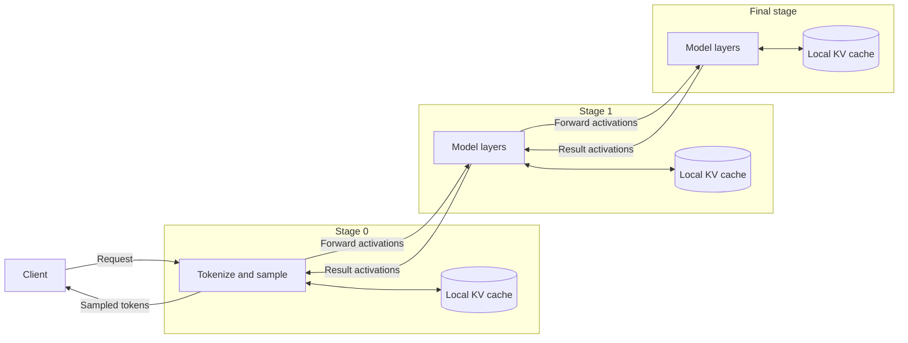

# Pipeline parallelism

Skippy can divide a model into contiguous stages when one device cannot host
the complete workload. It does not discover peers or automatically form a
cluster: the operator supplies an ordered set of worker addresses and one
verified model.

Use pipeline parallelism when a verified model cannot fit on one device or
machine and the participating workers have a stable, private network path.
Prefer single-machine serving when the complete workload fits because it avoids
activation transfer and multi-worker coordination.



Stage zero owns tokenization, sampling, sessions, and the public OpenAI and
Anthropic APIs. Downstream stages own admitted tensor closures and expose only
the internal binary activation transport. Every stage holds the KV state for
the model layers assigned to that stage; KV is not centralized on stage zero.

Before planning, make the exact model bytes available, choose one listener per
stage, and install compatible native runtimes on every worker.

## Create a plan

```console
skippy plan-split \
  --model-path /models/model.gguf \
  --model-id local-model \
  --worker 127.0.0.1:9400 \
  --worker 127.0.0.1:9401 \
  --output-dir split-plan
```

`plan-split` uses Skippy's shared direct-GGUF planner to balance contiguous
layer ranges across the supplied workers. It admits every native stage
before writing files. The generated
`stage-N.json` files are serving inputs; `admissions.json` is diagnostic
evidence, not a configuration file.

## Start downstream first

```console
skippy serve \
  --config split-plan/stage-1.json \
  --stage-transport binary \
  --worker-only

skippy serve \
  --config split-plan/stage-0.json \
  --stage-transport binary
```

```console
skippy prompt --endpoint http://127.0.0.1:9337/v1 --model local-model
```

## How a request moves through the pipeline

Stage zero tokenizes and admits the request, then sends activations through the
ordered downstream stages. Each stage evaluates only the tensors assigned by
the admitted plan. Results return to stage zero, which samples tokens, manages
the session, and writes the public API response.

Stage identity, tensor closure, activation width, and state handoff are part of
the admitted plan. If a worker, model, runtime, or topology no longer matches,
regenerate the plan rather than editing a stage file.

## Pipeline reference

| Task | Control |
| --- | --- |
| Create admitted stage files | `skippy plan-split` |
| Start an internal worker | `skippy serve --config FILE --stage-transport binary --worker-only` |
| Start public stage zero | `skippy serve --config FILE --stage-transport binary` |
| Set worker order | Repeated ordered `--worker ADDRESS` values |
| Change topology or boundaries | Generate a new plan |

Regenerate the plan whenever the topology, model, runtime, or stage boundaries
change. Do not hand-edit admitted stage files.
