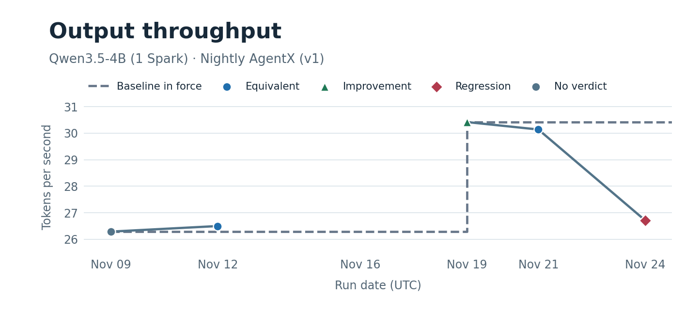
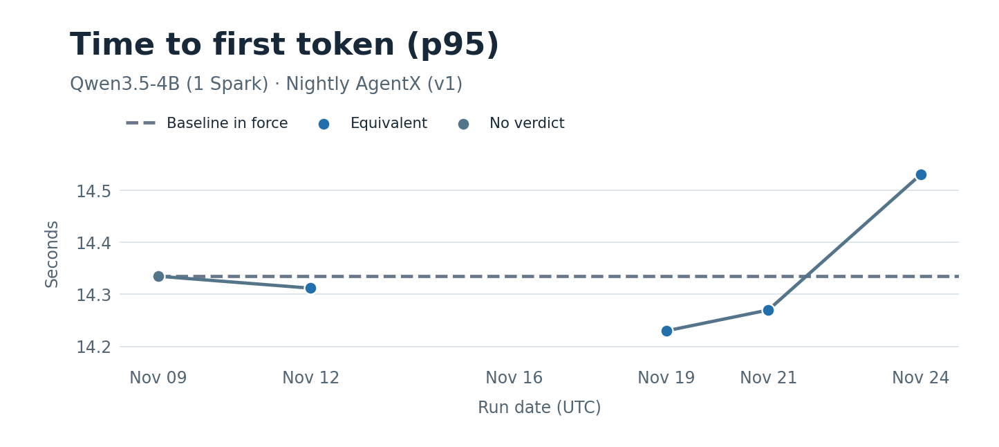
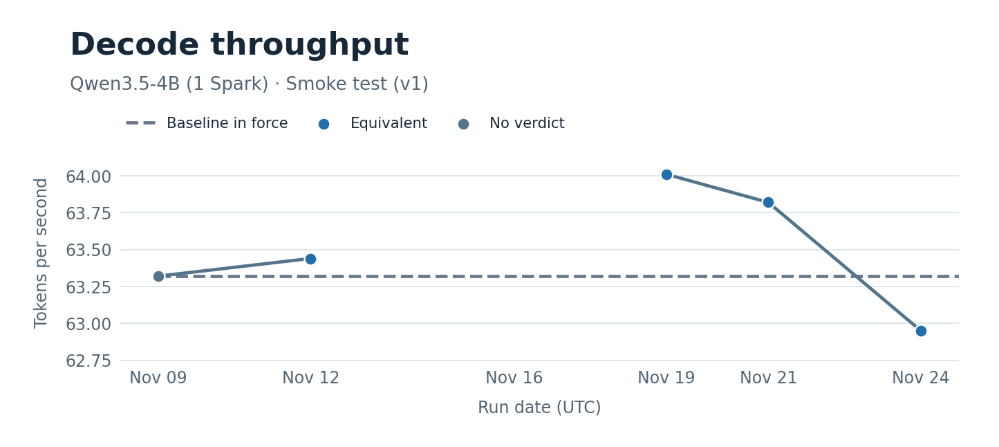

# Skippy inference qualification

Nightly performance and correctness results from Skippy’s main branch.

**Preview.** Awaiting the first nightly publication. The values, dates, and commit IDs on this card are illustrative.

## Latest results (preview)

**Failed** · nightly profile · `cccccccccccc` · 2026-11-24 14:00 UTC · Run nightly-regression

Illustrative scenario. Correctness passed. Output throughput fell 12.20% against the saved baseline, exceeding the 5% tolerance. The saved baseline stays at 30.42 tok/s.

### Lab outcomes

| Configuration | Qualification | Evidence |
| --- | --- | --- |
| Qwen3.5-4B (1 Spark) | Passed | — |

### Nightly AgentX (v1)

| Configuration | Metric | This run | Saved baseline | Baseline commit | Change vs saved | Comparison |
| --- | --- | --- | --- | --- | --- | --- |
| Qwen3.5-4B (1 Spark) | Output throughput | 26.71 tok/s | 30.42 tok/s | `bbbbbbbbbbbb` | -12.20% | Regression |
| Qwen3.5-4B (1 Spark) | Time to first token (p95) | 14,531 ms | 14,335 ms | `aaaaaaaaaaaa` | +1.37% | Within tolerance |

### Smoke test (v1)

| Configuration | Metric | This run | Saved baseline | Baseline commit | Change vs saved | Comparison |
| --- | --- | --- | --- | --- | --- | --- |
| Qwen3.5-4B (1 Spark) | Decode throughput | 62.95 tok/s | 63.32 tok/s | `aaaaaaaaaaaa` | -0.58% | Within tolerance |

## Performance over time

Up to 30 days ending at the latest run shown. The dashed line marks the active baseline. Missing measurements leave gaps.

Qwen3.5-4B (1 Spark) · Nightly AgentX (v1)

Qwen3.5-4B (1 Spark) · Nightly AgentX (v1)

Qwen3.5-4B (1 Spark) · Smoke test (v1)

## Saved baselines (preview)

| Configuration | Workload | Metric | Baseline | Reference SHA |
| --- | --- | --- | --- | --- |
| Qwen3.5-4B (1 Spark) | Nightly AgentX (v1) | Output throughput | 30.42 tok/s | `bbbbbbbbbbbb` |
| Qwen3.5-4B (1 Spark) | Nightly AgentX (v1) | Time to first token (p95) | 14,335 ms | `aaaaaaaaaaaa` |
| Qwen3.5-4B (1 Spark) | Smoke test (v1) | Prefill throughput | 612.17 tok/s | `aaaaaaaaaaaa` |
| Qwen3.5-4B (1 Spark) | Smoke test (v1) | Decode throughput | 63.32 tok/s | `aaaaaaaaaaaa` |

## Recent runs

| Run | Started (UTC) | Profile | Tested SHA | Outcome | Coverage |
| --- | --- | --- | --- | --- | --- |
| nightly-regression | 2026-11-24 14:00 | nightly | `cccccccccccc` | Failed | 1/1 configurations passed |
| nightly-steady | 2026-11-21 14:00 | nightly | `333333333333` | Passed | 1/1 configurations passed |
| nightly-promotion | 2026-11-19 14:00 | nightly | `bbbbbbbbbbbb` | Passed | 1/1 configurations passed |
| nightly-gap | 2026-11-16 14:00 | nightly | `222222222222` | Incomplete | 0/1 configurations passed |
| nightly-stable | 2026-11-12 14:00 | nightly | `111111111111` | Passed | 1/1 configurations passed |
| nightly-seed | 2026-11-09 14:00 | nightly | `aaaaaaaaaaaa` | Passed | 1/1 configurations passed |

## Recent measurements

Run times are in UTC.

| Workload | Configuration | Metric | Nov 24 14:00 | Nov 21 14:00 | Nov 19 14:00 | Nov 16 14:00 | Nov 12 14:00 |
| --- | --- | --- | --- | --- | --- | --- | --- |
| Nightly AgentX (v1) | Qwen3.5-4B (1 Spark) | Output throughput | 26.71 tok/s | 30.14 tok/s | 30.42 tok/s | — | 26.5 tok/s |
| Nightly AgentX (v1) | Qwen3.5-4B (1 Spark) | Time to first token (p95) | 14,531 ms | 14,270 ms | 14,230 ms | — | 14,312 ms |
| Smoke test (v1) | Qwen3.5-4B (1 Spark) | Decode throughput | 62.95 tok/s | 63.82 tok/s | 64.01 tok/s | — | 63.44 tok/s |

## Reading the results

Smoke prefill and decode rates and AgentX output throughput measure different workloads. Each comparison uses its own configuration and workload.

Changes are signed differences from the reference. Higher throughput and lower latency are favorable. Request error rate changes are shown in percentage points.

Qualification compares each measurement with the saved baseline using the configured tolerance. The baseline advances when the result meets the improvement threshold.
