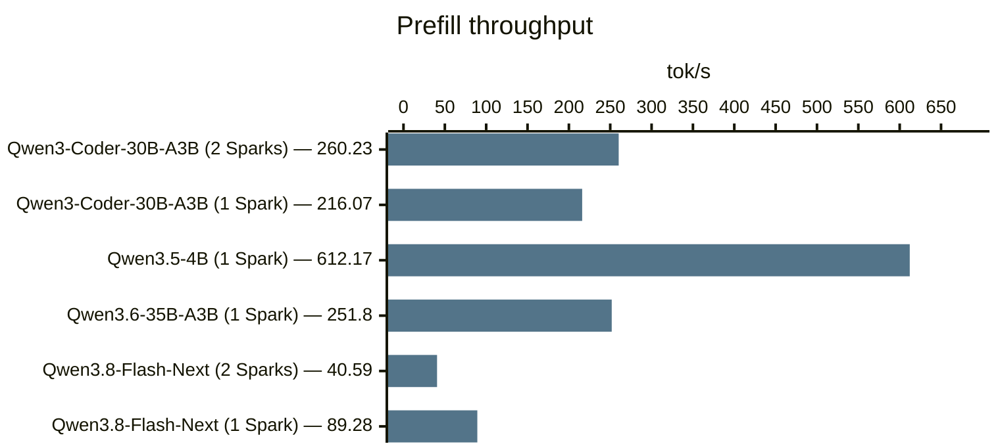
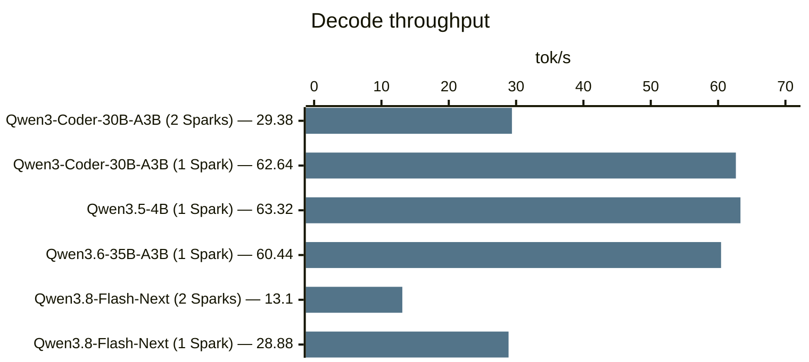

# Inference qualification

**Passed** · pr profile · `3f34c26a1811` · 2026-11-21 03:57 UTC · Run [main-smoke-recorded](https://github.com/Mesh-LLM/skippy/actions/runs/44863668933)

Recorded main workflow dispatch. All seven configurations passed. Six timing receipts were available. No comparison baseline was published for this run.

## Performance charts

Smoke test (v1). Slate = measurement without a verdict.

Smoke test (v1). Slate = measurement without a verdict.

## Lab outcomes

| Configuration | Qualification | Evidence |
| --- | --- | --- |
| Qwen3-Coder-30B-A3B (2 Sparks) | Passed | [Lab record](https://pilot.jianyang.cloud/jobs/job_xx9qwgvp1jm5680) |
| Qwen3-Coder-30B-A3B (1 Spark) | Passed | [Lab record](https://pilot.jianyang.cloud/jobs/job_ewb6q82wjhx38pn) |
| Qwen3.5-4B (1 Spark) | Passed | [Lab record](https://pilot.jianyang.cloud/jobs/job_70j3kjgwf1y934c) |
| Qwen3.6-35B-A3B (2 Sparks) | Passed | [Lab record](https://pilot.jianyang.cloud/jobs/job_fwj351fp396t44t) |
| Qwen3.6-35B-A3B (1 Spark) | Passed | [Lab record](https://pilot.jianyang.cloud/jobs/job_2324qg3fnx0pgbh) |
| Qwen3.8-Flash-Next (2 Sparks) | Passed | [Lab record](https://pilot.jianyang.cloud/jobs/job_ssq2mwkdbamy36a) |
| Qwen3.8-Flash-Next (1 Spark) | Passed | [Lab record](https://pilot.jianyang.cloud/jobs/job_yh8wtjtb4hkztha) |

## Smoke test (v1)

| Configuration | Metric | This run | Saved baseline | Baseline commit | Change vs saved | Comparison |
| --- | --- | --- | --- | --- | --- | --- |
| Qwen3-Coder-30B-A3B (2 Sparks) | Prefill throughput | 260.23 tok/s | — | — | — | No matching baseline |
| Qwen3-Coder-30B-A3B (2 Sparks) | Decode throughput | 29.38 tok/s | — | — | — | No matching baseline |
| Qwen3-Coder-30B-A3B (1 Spark) | Prefill throughput | 216.07 tok/s | — | — | — | No matching baseline |
| Qwen3-Coder-30B-A3B (1 Spark) | Decode throughput | 62.64 tok/s | — | — | — | No matching baseline |
| Qwen3.5-4B (1 Spark) | Prefill throughput | 612.17 tok/s | — | — | — | No matching baseline |
| Qwen3.5-4B (1 Spark) | Decode throughput | 63.32 tok/s | — | — | — | No matching baseline |
| Qwen3.6-35B-A3B (2 Sparks) | Prefill throughput | — | — | — | — | Measurement unavailable · Timing receipt unavailable in GitHub Actions |
| Qwen3.6-35B-A3B (2 Sparks) | Decode throughput | — | — | — | — | Measurement unavailable · Timing receipt unavailable in GitHub Actions |
| Qwen3.6-35B-A3B (1 Spark) | Prefill throughput | 251.8 tok/s | — | — | — | No matching baseline |
| Qwen3.6-35B-A3B (1 Spark) | Decode throughput | 60.44 tok/s | — | — | — | No matching baseline |
| Qwen3.8-Flash-Next (2 Sparks) | Prefill throughput | 40.59 tok/s | — | — | — | No matching baseline |
| Qwen3.8-Flash-Next (2 Sparks) | Decode throughput | 13.1 tok/s | — | — | — | No matching baseline |
| Qwen3.8-Flash-Next (1 Spark) | Prefill throughput | 89.28 tok/s | — | — | — | No matching baseline |
| Qwen3.8-Flash-Next (1 Spark) | Decode throughput | 28.88 tok/s | — | — | — | No matching baseline |
