# Inference qualification

**Passed** · nightly profile · `bbbbbbbbbbbb` · 2026-11-19 14:00 UTC · Run nightly-promotion

Published baseline snapshot [`eeeeeeeeeeee`](https://huggingface.co/datasets/meshllm/skippy-inference-qualification/blob/eeeeeeeeeeeeeeeeeeeeeeeeeeeeeeeeeeeeeeee/baselines.json)

Illustrative scenario. Output throughput rose 15.71% against the saved baseline and exceeded the 5% improvement threshold. The new baseline is 30.42 tok/s.

## Performance charts

Qwen3.5-4B (1 Spark) · Nightly AgentX (v1). Gray = saved baseline · Green = improvement.

```mermaid
---
config:
  xyChart:
    width: 760
    height: 290
    yAxis:
      showLabel: false
      showTick: false
  themeVariables:
    xyChart:
      plotColorPalette: "#68778A, #207956"
---
xychart-beta
    title "Output throughput"
    x-axis ["Saved baseline — 26.29", "This run — 30.42"]
    y-axis "tok/s" 0 --> 35
    bar [26.29, 0]
    bar [0, 30.42]
```

Qwen3.5-4B (1 Spark) · Nightly AgentX (v1). Gray = saved baseline · Blue = equivalent (within tolerance).

```mermaid
---
config:
  xyChart:
    width: 760
    height: 290
    yAxis:
      showLabel: false
      showTick: false
  themeVariables:
    xyChart:
      plotColorPalette: "#68778A, #216FAD"
---
xychart-beta
    title "Time to first token (p95)"
    x-axis ["Saved baseline — 14335", "This run — 14230"]
    y-axis "ms" 0 --> 17000
    bar [14335, 0]
    bar [0, 14230]
```

Qwen3.5-4B (1 Spark) · Smoke test (v1). Gray = saved baseline · Blue = equivalent (within tolerance).

```mermaid
---
config:
  xyChart:
    width: 760
    height: 290
    yAxis:
      showLabel: false
      showTick: false
  themeVariables:
    xyChart:
      plotColorPalette: "#68778A, #216FAD"
---
xychart-beta
    title "Decode throughput"
    x-axis ["Saved baseline — 63.32", "This run — 64.01"]
    y-axis "tok/s" 0 --> 72
    bar [63.32, 0]
    bar [0, 64.01]
```

## Lab outcomes

| Configuration | Qualification | Evidence |
| --- | --- | --- |
| Qwen3.5-4B (1 Spark) | Passed | — |

## Nightly AgentX (v1)

| Configuration | Metric | This run | Saved baseline | Baseline commit | Change vs saved | Comparison |
| --- | --- | --- | --- | --- | --- | --- |
| Qwen3.5-4B (1 Spark) | Output throughput | 30.42 tok/s | 26.29 tok/s | `aaaaaaaaaaaa` | +15.71% | Improvement |
| Qwen3.5-4B (1 Spark) | Time to first token (p95) | 14,230 ms | 14,335 ms | `aaaaaaaaaaaa` | -0.73% | Within tolerance |

## Smoke test (v1)

| Configuration | Metric | This run | Saved baseline | Baseline commit | Change vs saved | Comparison |
| --- | --- | --- | --- | --- | --- | --- |
| Qwen3.5-4B (1 Spark) | Decode throughput | 64.01 tok/s | 63.32 tok/s | `aaaaaaaaaaaa` | +1.09% | Within tolerance |

## Baseline updates

| Configuration | Workload | Metric | Action | New baseline |
| --- | --- | --- | --- | --- |
| Qwen3.5-4B (1 Spark) | Nightly AgentX (v1) | Output throughput | Promoted | 30.42 tok/s |
