# Inference qualification

**Failed** · nightly profile · `cccccccccccc` · 2026-11-24 14:00 UTC · Run nightly-regression

Published baseline snapshot [`ffffffffffff`](https://huggingface.co/datasets/meshllm/skippy-inference-qualification/blob/ffffffffffffffffffffffffffffffffffffffff/baselines.json)

Illustrative scenario. Correctness passed. Output throughput fell 12.20% against the saved baseline, exceeding the 5% tolerance. The saved baseline stays at 30.42 tok/s.

## Performance charts

Qwen3.5-4B (1 Spark) · Nightly AgentX (v1). Gray = saved baseline · Red = regression.

```mermaid
---
config:
  xyChart:
    width: 760
    height: 290
    yAxis:
      showLabel: false
      showTick: false
  themeVariables:
    xyChart:
      plotColorPalette: "#68778A, #B13A4D"
---
xychart-beta
    title "Output throughput"
    x-axis ["Saved baseline — 30.42", "This run — 26.71"]
    y-axis "tok/s" 0 --> 35
    bar [30.42, 0]
    bar [0, 26.71]
```

Qwen3.5-4B (1 Spark) · Nightly AgentX (v1). Gray = saved baseline · Blue = equivalent (within tolerance).

```mermaid
---
config:
  xyChart:
    width: 760
    height: 290
    yAxis:
      showLabel: false
      showTick: false
  themeVariables:
    xyChart:
      plotColorPalette: "#68778A, #216FAD"
---
xychart-beta
    title "Time to first token (p95)"
    x-axis ["Saved baseline — 14335", "This run — 14531"]
    y-axis "ms" 0 --> 17000
    bar [14335, 0]
    bar [0, 14531]
```

Qwen3.5-4B (1 Spark) · Smoke test (v1). Gray = saved baseline · Blue = equivalent (within tolerance).

```mermaid
---
config:
  xyChart:
    width: 760
    height: 290
    yAxis:
      showLabel: false
      showTick: false
  themeVariables:
    xyChart:
      plotColorPalette: "#68778A, #216FAD"
---
xychart-beta
    title "Decode throughput"
    x-axis ["Saved baseline — 63.32", "This run — 62.95"]
    y-axis "tok/s" 0 --> 71
    bar [63.32, 0]
    bar [0, 62.95]
```

## Lab outcomes

| Configuration | Qualification | Evidence |
| --- | --- | --- |
| Qwen3.5-4B (1 Spark) | Passed | — |

## Nightly AgentX (v1)

| Configuration | Metric | This run | Saved baseline | Baseline commit | Change vs saved | Comparison |
| --- | --- | --- | --- | --- | --- | --- |
| Qwen3.5-4B (1 Spark) | Output throughput | 26.71 tok/s | 30.42 tok/s | `bbbbbbbbbbbb` | -12.20% | Regression |
| Qwen3.5-4B (1 Spark) | Time to first token (p95) | 14,531 ms | 14,335 ms | `aaaaaaaaaaaa` | +1.37% | Within tolerance |

## Smoke test (v1)

| Configuration | Metric | This run | Saved baseline | Baseline commit | Change vs saved | Comparison |
| --- | --- | --- | --- | --- | --- | --- |
| Qwen3.5-4B (1 Spark) | Decode throughput | 62.95 tok/s | 63.32 tok/s | `aaaaaaaaaaaa` | -0.58% | Within tolerance |
