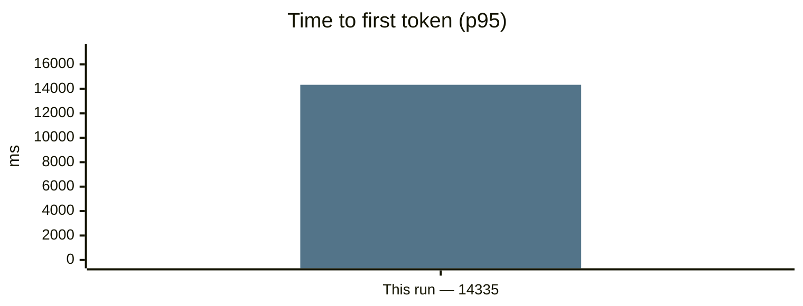
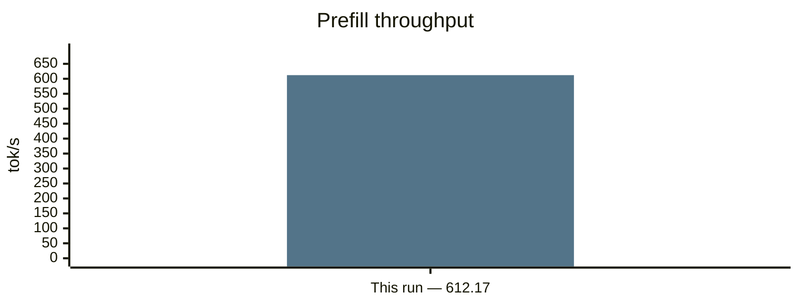
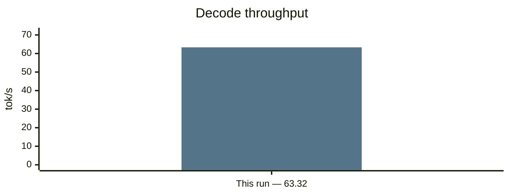

# Inference qualification

**Passed** · nightly profile · `aaaaaaaaaaaa` · 2026-11-09 14:00 UTC · Run nightly-seed

Illustrative scenario using sample results.

## Performance charts

Qwen3.5-4B (1 Spark) · Nightly AgentX (v1). Slate = measurement without a verdict.

Qwen3.5-4B (1 Spark) · Nightly AgentX (v1). Slate = measurement without a verdict.

Qwen3.5-4B (1 Spark) · Smoke test (v1). Slate = measurement without a verdict.

Qwen3.5-4B (1 Spark) · Smoke test (v1). Slate = measurement without a verdict.

## Lab outcomes

| Configuration | Qualification | Evidence |
| --- | --- | --- |
| Qwen3.5-4B (1 Spark) | Passed | — |

## Nightly AgentX (v1)

| Configuration | Metric | This run | Saved baseline | Baseline commit | Change vs saved | Comparison |
| --- | --- | --- | --- | --- | --- | --- |
| Qwen3.5-4B (1 Spark) | Output throughput | 26.29 tok/s | — | — | — | No matching baseline |
| Qwen3.5-4B (1 Spark) | Time to first token (p95) | 14,335 ms | — | — | — | No matching baseline |

## Smoke test (v1)

| Configuration | Metric | This run | Saved baseline | Baseline commit | Change vs saved | Comparison |
| --- | --- | --- | --- | --- | --- | --- |
| Qwen3.5-4B (1 Spark) | Prefill throughput | 612.17 tok/s | — | — | — | No matching baseline |
| Qwen3.5-4B (1 Spark) | Decode throughput | 63.32 tok/s | — | — | — | No matching baseline |

## Baseline updates

| Configuration | Workload | Metric | Action | New baseline |
| --- | --- | --- | --- | --- |
| Qwen3.5-4B (1 Spark) | Nightly AgentX (v1) | Output throughput | Seeded | 26.29 tok/s |
| Qwen3.5-4B (1 Spark) | Nightly AgentX (v1) | Time to first token (p95) | Seeded | 14,335 ms |
| Qwen3.5-4B (1 Spark) | Smoke test (v1) | Prefill throughput | Seeded | 612.17 tok/s |
| Qwen3.5-4B (1 Spark) | Smoke test (v1) | Decode throughput | Seeded | 63.32 tok/s |
