# Inference qualification

**Failed** · pr profile · `eeeeeeeeeeee` · 2026-11-24 17:30 UTC · Run pr-regression

Published baseline snapshot [`ffffffffffff`](https://huggingface.co/datasets/meshllm/skippy-inference-qualification/blob/ffffffffffffffffffffffffffffffffffffffff/baselines.json)

Illustrative qualifying PR. Decode throughput fell 5.09% against the saved baseline, exceeding the 5% tolerance.

## Performance charts

Qwen3.5-4B (1 Spark) · Smoke test (v1). Gray = saved baseline · Blue = equivalent (within tolerance).

```mermaid
---
config:
  xyChart:
    width: 760
    height: 290
    yAxis:
      showLabel: false
      showTick: false
  themeVariables:
    xyChart:
      plotColorPalette: "#68778A, #216FAD"
---
xychart-beta
    title "Prefill throughput"
    x-axis ["Saved baseline — 612.17", "This run — 611.12"]
    y-axis "tok/s" 0 --> 690
    bar [612.17, 0]
    bar [0, 611.12]
```

Qwen3.5-4B (1 Spark) · Smoke test (v1). Gray = saved baseline · Red = regression.

```mermaid
---
config:
  xyChart:
    width: 760
    height: 290
    yAxis:
      showLabel: false
      showTick: false
  themeVariables:
    xyChart:
      plotColorPalette: "#68778A, #B13A4D"
---
xychart-beta
    title "Decode throughput"
    x-axis ["Saved baseline — 63.32", "This run — 60.1"]
    y-axis "tok/s" 0 --> 71
    bar [63.32, 0]
    bar [0, 60.1]
```

## Lab outcomes

| Configuration | Qualification | Evidence |
| --- | --- | --- |
| Qwen3.5-4B (1 Spark) | Passed | — |

## Smoke test (v1)

| Configuration | Metric | This run | Saved baseline | Baseline commit | Change vs saved | Comparison |
| --- | --- | --- | --- | --- | --- | --- |
| Qwen3.5-4B (1 Spark) | Prefill throughput | 611.12 tok/s | 612.17 tok/s | `aaaaaaaaaaaa` | -0.17% | Within tolerance |
| Qwen3.5-4B (1 Spark) | Decode throughput | 60.1 tok/s | 63.32 tok/s | `aaaaaaaaaaaa` | -5.09% | Regression |
